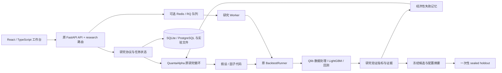

# Agentic Quant Research Platform：工程架构

本项目在 **QuantaAlpha** 上做增量开发。QuantaAlpha 原有的因子挖掘、表达式计算、Qlib 回测、CLI 和 React 工作台是基础；新增的 `quantaalpha/research` 管理研究协议、经济性失败记忆、候选冻结和最终样本外验证。v1 面向单用户、日频、离线研究。

## 系统边界

LLM 只参与研究层的假设、代码和下一轮实验建议。回测、成本计算、模型训练与指标由确定性计算组件执行。v1 的无密钥演示使用明确标记的确定性候选与合成行情；它仍调用原来的 Qlib / LightGBM 训练和回测，不把预设净值当作实验结果。

## 复用与新增

| 路径 | 职责 | 来源 |
| --- | --- | --- |
| `quantaalpha/pipeline/` | 原因子挖掘与轨迹进化流程 | QuantaAlpha |
| `quantaalpha/factors/`、`quantaalpha/components/` | 原因子实现、数据与研究组件 | QuantaAlpha |
| `quantaalpha/backtest/` | 因子加载、数据集建立、模型训练和 Qlib 回测 | QuantaAlpha |
| `configs/` | 原挖掘与独立回测配置 | QuantaAlpha，按实验使用派生配置 |
| `frontend-v2/` | 原 React / TypeScript 工作台与 FastAPI 服务 | QuantaAlpha，增量接入研究协议界面与 API |
| `quantaalpha/research/` | 协议、演示数据、实验编排、失败记忆与证据导出 | 本项目新增 |
| `docs/RESEARCH_PROTOCOL.md` | 四窗口切分、冻结、holdout 与消融规则 | 本项目新增 |

上游归属、来源 SHA 和增量的创新边界见 [UPSTREAM_AND_INNOVATION.md](UPSTREAM_AND_INNOVATION.md)。

## 数据与实验生命周期

1. 登记数据指纹、交易日历、预测标签跨度及执行成本配置。
2. 将时间轴划分为 `train`、`tune`、`research_validation`、`sealed_holdout`，相邻窗口保留至少两个交易日的 purge gap。
3. 原 BacktestRunner 使用训练与调参窗口训练模型；研究候选只在 `research_validation` 上比较。
4. 将可核查的经济性失败及其上下文写入记忆。取回记忆时匹配数据、窗口和执行配置，防止无关经验混用。
5. 选定候选后冻结表达式、参数、数据和执行配置的摘要。
6. 使用冻结候选申请一次最终 holdout。结果用于报告，不再用于本协议的候选选择或失败记忆学习。
7. 导出协议、候选、指标、事件、配置与证据，保留复算所需信息。

进程重启后可以查看已持久化记录。本地线程模式下，中断任务会被标记为 interrupted；Redis/RQ 模式下任务由独立 Worker 执行，API 重启不会自动重新执行最终测试。数据库 CAS 同时防止重复队列投递导致重复执行。

实验编排对拒绝提案按预算留痕，并在每次尝试后保存检查点；全组失败通过 `ResearchExecutionError.partial_result` 将部分证据交给任务存储。必要指标及曲线的非有限数值会被拒绝。`report.py` 从持久化协议和结果生成中文 Markdown，经研究 API 下载；它不参与候选生成，也不额外请求模型。

## 运行与持久化

- API 沿用 `frontend-v2/backend/app.py`，默认端口为 `8000`。
- 本地开发前端沿用 Vite，配置端口为 `3000`，将 `/api`、`/ws` 代理到本地后端。
- 研究 API 统一使用 `/api/v1/research` 前缀；原挖掘、因子库与回测路由保留。
- 默认实验目录由 `AQR_DATA_DIR` 指定，未配置时使用 `data/results/research`。
- 默认任务与协议记录使用 SQLite；经济失败记忆使用 `AQR_MEMORY_PATH` 对应的 SQLite 文件。
- `AQR_DATABASE_URL` 可选择 PostgreSQL，`AQR_REDIS_URL` 可选择 Redis/RQ。两项都未配置时无需外部服务即可使用 SQLite 与本地线程。
- PostgreSQL 16 与 Redis 7 已完成独立端到端验收：入队、Worker 真正运行 Qlib、结果持久化、冻结与最终评估，详见 [VALIDATION.md](VALIDATION.md)。

## 部署范围

Docker 目标是把构建后的网页和 API 放在同一容器，避免跨域和额外的网页代理服务；研究产物挂载到 `/app/data`。镜像构建与容器启动是否已经验证，以实际交付测试记录为准。

v1 没有实盘交易网关、自研 C++ 撮合引擎、订单簿历史重建或高频执行能力。后续如果研究问题需要微观结构，可以作为独立执行模块扩展。PyTorch 模型可沿用上游模型生态扩展；当前演示实际执行的是 Qlib / LightGBM CPU 路线，不应表述为已经完成深度模型训练。

## 工程扩展顺序

后续优先验证真实数据上的研究协议、成本敏感性和多种子等预算消融，再扩展模型族。需要多用户部署时，再补齐身份认证、权限、数据隔离和生成代码的进程隔离。研究协议中的访问限制属于本地工具约束，不是数据拥有者无法绕过的安全隔离。
